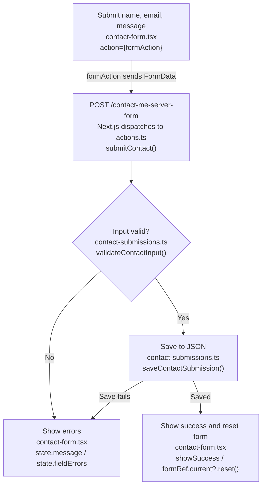

# Portfolio and Contact Form — Video Submission Script

Estimated duration: 6–7 minutes, including navigation, typing, and pauses for results. Timing is a rehearsal estimate.

Read the blockquotes as narration, adapting the wording to your speaking style. Italic text gives screen-recording directions and is not spoken. Describe each result after it appears on screen.

Before recording, run the app with `npm run dev` and use the local URL printed in the terminal. Keep the browser address bar visible, confirm that Resume Site and Task Tracker are listed, and have the linked source files ready. Sign in to the admin area beforehand if using the final saved-message demonstration.

| Approximate time | What to show | Rubric coverage |
| --- | --- | --- |
| 0:00–1:30 | Home, About Me, My Projects, both project detail URLs, and Contact Me | A2-13: four pages and two dynamic values |
| 1:30–2:45 | Empty submission, malformed email, and successful submission | A2-13: invalid and valid submissions |
| 2:45–6:00 | Network request and the complete form-to-server-to-feedback path | A2-14: accurate explanation of the flow |
| 6:00–6:30 | The saved message in Contact Requests or JSON storage | Supporting evidence that the valid submission was saved |

*Start at `/`. Show the welcome text and Featured Projects.*

> This portfolio introduces my background, presents my projects, and lets visitors send a contact request. I’ll show the four main pages, open two different project records, and demonstrate what happens when the contact form receives invalid and valid information.
>
> The Home page gives visitors an introduction and links to featured projects.

*Click **About Me** in the navigation. Show `/about-me`, then scroll through the introduction, Skills, Education, and Experience.*

> About Me gives more detail about my background. It brings together my introduction, skills, education, and experience.

*Click **My Projects**. Show `/projects` and both project cards.*

> My Projects lists the available projects. Each card links to a detail page using that project’s slug, which is the identifying part of its URL.

*Click **Resume Site**. Hold on `/projects/resume-site`, its title, description, and tech stack. Return through **My Projects**, then click **Task Tracker**. Hold on `/projects/task-tracker` and its different content.*

> The first URL uses resume-site and displays the Resume Site record. The second uses task-tracker and displays the Task Tracker record.
>
> Both use the same dynamic route, projects slash slug. The page reads the slug from the URL, looks up the matching project, and displays that record. Changing the slug changes the content while keeping the same page structure.

*Briefly visit `/projects/not-a-real-project` and show “Page not found.” This extra check supports the unknown-value requirement in A2-02. Then click **Contact Me** in the navigation.*

> An unknown slug displays the not-found page because there is no matching project.
>
> The fourth main page is Contact Me. It has labeled fields for name, email, and message, followed by the Send Message button.

*On `/contact-me-server-form`, leave all three fields empty and click **Send Message**. Hold on the general error and “Name is required,” “Email is required,” and “Message is required.”*

> First, I’m submitting an empty form. The server rejects it and returns an error for each required field. The page shows those errors beside the inputs so the visitor knows what to fix.

*Fill all fields again: Name = `Alex Demo`, Email = `alex-at-example.com`, Message = `A2 recording: project inquiry.` Click **Send Message**. Hold on “Enter a valid email address.”*

> This time the name and message are filled in, but the email is malformed. The server rejects this submission too and identifies the email field as the problem.

*Enter all three values again, using `Alex Demo`, `alex@example.com`, and `A2 recording: project inquiry.` Open Developer Tools → Network, clear the request list, and keep the form visible. Click **Send Message**. Show the success confirmation immediately, before it fades. If the pending state is too brief to see, explain it later from the code.*

> With a valid email and all required fields filled in, the submission succeeds. The confirmation appears and the fields reset. After five seconds, the confirmation begins fading out.

*Select the submission request in Network. Show its request URL and POST method, then locate the submitted name, email, and message in its payload. Keep this request available while explaining the code.*

> This request connects the form to the server. Next.js sends a POST request to the contact page’s URL and identifies the Server Action to run. In this implementation, submitContact is the server handler reached through that request.

*Use this flowchart during the A2-14 explanation: “Explains the form-to-endpoint flow accurately in your own words.” Follow the arrows from the visitor’s inputs to the server and back to the feedback.*

*The returned result reaches the form through `useActionState`, which updates the visible feedback.*

*JSON storage defaults to `data/contact-submissions.json`; `PORTFOLIO_DATA_DIR` can change its directory. A successful submission saves a contact request for the administrator to review.*

> When I submit the form, its named fields become the data sent to the contact page’s server endpoint. Next.js routes that request to submitContact, which checks the values and saves them only if they pass validation. The action returns a result that updates the form: errors explain what went wrong, while success shows a confirmation and clears the fields.

*Open [page.tsx](src/app/contact-me-server-form/page.tsx), then [contact-form.tsx](src/app/contact-me-server-form/contact-form.tsx). Point to `<ContactForm />`, the input `name` attributes, `useActionState`, and `<form action={formAction} noValidate>`.*

> The page component displays the heading and ContactForm. The form component handles the interactive interface. Each input’s name attribute gives its submitted value a key: name, email, or message.
>
> useActionState connects submitContact to the form. It provides the latest result, the formAction function used by the form, and isPending. While the request is running, isPending disables the button and changes its text to Sending.
>
> The form uses noValidate, so the validation messages we just saw come from the server’s checks.

*Open [actions.ts](src/app/contact-me-server-form/actions.ts). Point to `"use server"`, `submitContact`, the `formData.get(...)` calls, and the validation branch.*

> The use server directive marks this function to run on the server. Next.js handles the request dispatch. submitContact receives the previous form state and FormData containing the submitted fields.
>
> It reads each field by name and passes the values to validateContactInput. Validation happens before saving because a request can contain missing or incorrect values regardless of what the interface displays.

*Open [contact-submissions.ts](src/lib/contact-submissions.ts) at `validateContactInput`, and briefly show [validation.ts](src/lib/validation.ts) for the email check. Return to the early error return in `actions.ts`.*

> Validation checks for empty or space-only fields and checks the email’s format. If any check fails, the action returns an error status, a general message, and field-specific errors. It returns before calling the save function, which explains why the invalid attempts are rejected.

*Show `saveContactSubmission` in `contact-submissions.ts`, then the awaited save and success return in `actions.ts`.*

> If validation passes, saveContactSubmission trims the values, adds a unique ID and timestamp, and appends the record to JSON storage. The default file is data slash contact-submissions dot JSON.
>
> The action waits for saving to finish before returning success. If saving throws an error, the catch block returns a failure message asking the visitor to try again.

*Return to `contact-form.tsx`. Point to `state.status`, `state.fieldErrors`, and the success `useEffect`. Briefly show [form-state.ts](src/app/contact-me-server-form/form-state.ts) if helpful.*

> The returned result becomes the new state in useActionState. The component uses that state to display either the confirmation or the errors. On success, the effect resets the form and starts the confirmation’s dismissal timers. That completes the path from the visitor’s inputs, through the server, back to visible feedback.

*Open or refresh `/admin/contacts` while signed in. Locate the new `Alex Demo` entry and show its email, message, and submission time. Alternatively, show the matching record in the active `contact-submissions.json` file. If `PORTFOLIO_DATA_DIR` is configured, use that directory rather than the default `data` folder.*

> Here is the message from the successful submission, with the same email and message I entered. In this application, sending a message means saving a contact request for the administrator to review.

Before submitting the recording, check the actual footage against this list:

- [ ] All four main pages visibly loaded: `/`, `/about-me`, `/projects`, and `/contact-me-server-form`.
- [ ] Both dynamic values appeared in the address bar with different records: `/projects/resume-site` and `/projects/task-tracker`.
- [ ] An empty submission and a malformed-email submission showed validation feedback.
- [ ] A valid submission showed the success confirmation.
- [ ] The explanation connected named form fields → `formAction` → POST request → `submitContact` → server validation → JSON save → returned state → visible feedback.
- [ ] The spoken explanation matched the results shown on screen and used wording you can explain comfortably.
